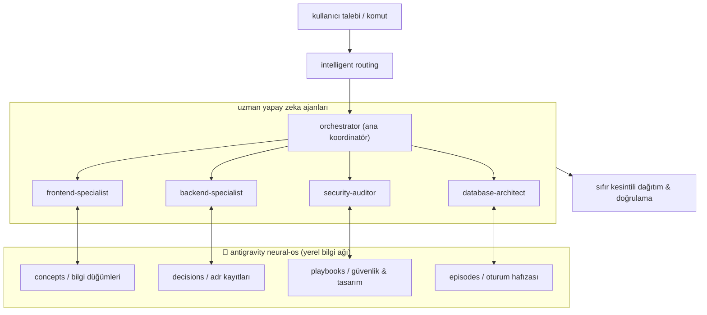

# 🏛️ kurumsal sistem mimarisi (architecture overview)

bu düğüm, antigravity ekosisteminin çekirdek mimari bileşenlerini, ajan sorumluluklarını ve veri akış hiyerarşisini tanımlar.

---

## 🧩 mimari bileşenler ve etkileşim şeması

---

## 📌 ilgili bağlantılar
- ana indeks: [[INDEX]]
- kodlama ilkeleri: [[clean-code-principles]]
- mimari karar: [[adr-001-autonomous-neural-vault]]
